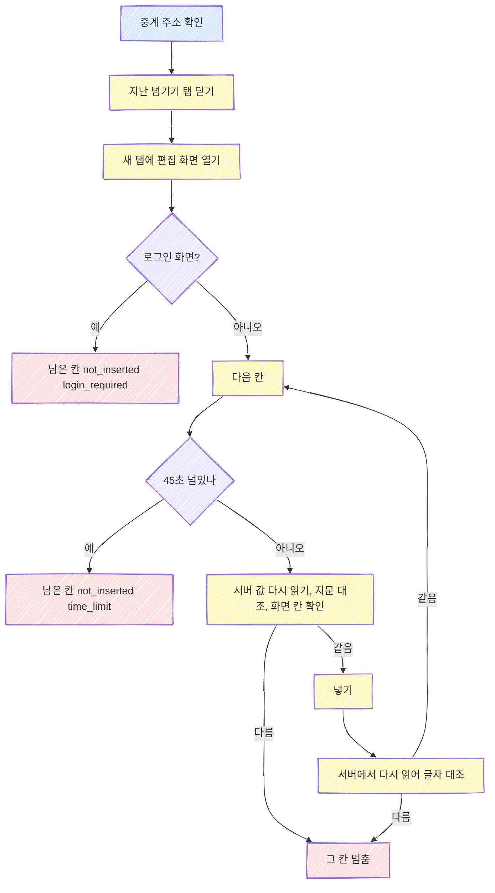

# 비서 웹에서 원티드 프로필 반영 기술 설계

스펙: [`spec.md`](spec.md). 첫 PR(원티드) 기준이다. LinkedIn PR 은 이 설계의 브라우저 연결과 실행 규칙을 다시 쓰고, 사이트 모듈만 더한다.

## 요구사항 연결

| ID | 해결 방법 |
| --- | --- |
| REQ1 | READ 도구 `get_wanted_resume` 가 「내 브라우저」 중계로 새 탭을 열고, 원티드 탭 안에서 이력서 API(`/api/chaos/resumes/v2/<resumeKey>`)를 불러 칸 목록을 만든다. 칸마다 `field`, `label`, `value`, `fingerprint` 를 돌려준다 |
| REQ2 | 비교와 표는 비서가 한다. 도구는 비교에 쓸 지금 값과 칸 이름을 준다. 연결용 지침에 「원고(`get_profile_document`)와 비교해 다른 칸만 표로」 순서를 둔다 |
| REQ3 | WRITE 도구 `update_wanted_resume` 를 `risk: WRITE`, `approval: required`, `outbound: true`, `grant: false` 로 선언한다. 대화 허락은 선언하지 않는다. 승인 인자 16KB 상한은 fos-assistant 가 승인 전에 막으므로, 「16KB 를 넘을 변경은 칸을 나눠 부른다」 를 도구 설명과 지침에 둔다. 플러그인의 16,000바이트 검사는 실행 단계의 보조 검사다 |
| REQ4 | 실행은 칸마다 「서버 값 다시 읽기, 지문 대조, 화면 칸 확인, 넣기, 서버 값 다시 읽기, 글자 대조」 를 한 칸씩 한다. 글 칸은 API 로, 기간 칸은 편집 화면을 새로 열어 다시 읽는다 |
| REQ5 | 실행 결과는 `isError` 없는 결과의 `results[]` 에 칸마다 `inserted`, `failed`, `not_inserted` 와 이유를 담는다. 첫 실패나 지문 불일치에서 루프를 끝낸다. 실행의 멈춤은 모두 `status: "stopped"` 이고 오류로 내지 않는다. 승인한 실행의 오류는 선언한 코드만 비서에게 가서 칸별 결과가 사라진다(fos-assistant ADR-092) |
| REQ6 | 읽기 도구는 원티드 탭이 로그인·보안 확인 화면이면 `isError` 없는 넘기기 결과(`need: "login"`)를 돌려주고 탭을 남긴다. 쓰기 도구는 같은 화면에서 넘기기 모양을 내지 않고 `status: "stopped"` 와 칸별 결과(남은 칸 `not_inserted`, 이유 `login_required`)를 돌려준다. 지침이 「멈췄다고 알리고 `get_wanted_resume` 을 다시 불러 카드를 띄운다」 를 시킨다(스펙 DECISION24) |
| REQ7 | 넣기 전에 칸을 찾지 못하거나 화면 칸 값이 서버 값과 다르면 그 칸을 `not_inserted`(`page_changed`)로 적고 멈춘다. 넣는 도중 화면이 기대와 다르면 `failed`(`page_changed`)다. 읽기 도구는 같은 경우 `CAREER_WANTED_PAGE_CHANGED` 오류를 낸다. 도구 설명이 대안(노트북 `sync-profile`, 직접 고치기)을 안내한다 |
| REQ8 | 기존 `save_profile_document` 를 그대로 쓴다. 지침이 반영 뒤 「넣은 칸만 원고에 반영해 저장안을 보이고 승인」 을 시킨다 |
| REQ9 | 읽기 결과의 `outOfScope`(기술, 링크, AI 활용 경험의 지금 값)는 읽기만 한다. 쓰기 인자의 `field` 는 `about` 과 프로젝트 칸 모양만 허용한다 |
| REQ10 | `career-connector` 지침의 원티드 제외 문구를 고치고 반영 순서를 짧게 더한다. 칸 규칙과 결과 상태의 뜻은 도구 설명에 둔다(스펙 DECISION11). 상한 테스트가 지킨다 |
| REQ11 | `CAREER_BROWSER_URL` 이 비었거나 중계가 답하지 않으면 탭을 열기 전에 `CAREER_BROWSER_UNREACHABLE` 로 끝낸다 |
| REQ12 | 지침에 「원고 문장과 사용자 문장만, 비서가 쓴 문장은 『비서 제안』, 새 사내 수치·조직명은 공개 여부를 먼저」 를 둔다. 도구는 관여하지 않는다 |
| REQ13 | `resumeKey` 없이 부르면 이력서 목록 화면을 읽어 하나면 그 이력서를, 여럿이면 `status: "choose"` 와 `resumes[]`(키, 제목, 고친 날짜)를 돌려준다. 쓰기 인자에 `resumeKey` 와 `resumeTitle` 이 필수다 |

## 책임과 경계

| 위치 | 책임 |
| --- | --- |
| `plugin/src/browser/cdp.ts` | 중계 주소로 Chrome 디버깅 HTTP 창구와 WebSocket 을 부르는 작은 CDP client. 사람 잠금(423, close 4423)을 `CAREER_BROWSER_IN_USE` 로 바꾼다. 원티드를 모른다 |
| `plugin/src/wanted/page.ts` | 원티드 탭 안에서 돌릴 스크립트(목록 읽기, 이력서 API 읽기, 글 칸 넣기, 기간 넣기, 화면 칸 값 읽기). `sync-profile` 의 zsh 스크립트를 옮긴 것이다 |
| `plugin/src/wanted/fields.ts` | 순수 로직. API 응답을 칸 목록으로 바꾸기, 정규화와 지문(DECISION13), 칸 id 모양, 인자 검사와 16KB 검사 |
| `plugin/src/wanted/tools.ts` | 두 도구의 흐름. 탭 열기와 닫기, 로그인 판정, 실행 루프와 시간 제한, 결과 모양 |
| `plugin/src/tools.ts`, `connector.json` | 도구 등록과 선언. 기존 `CareerTools.call` 에 두 도구를 더한다 |

데이터는 원티드 서버가 갖는다. 플러그인은 아무것도 저장하지 않는다. 읽기 도구가 넘기기로 남긴 탭 번호만 프로세스 메모리에 두고 같은 프로세스의 다음 호출이 닫는다(fos-assistant ADR-20261111 의 「남긴 탭」). 쓰기 도구는 승인한 실행이 대화와 다른 프로세스에서 돌아 그 메모리를 나누지 못하므로 탭을 남기지 않고 늘 닫는다.
의존 방향은 `wanted/tools.ts → wanted/page.ts, wanted/fields.ts, browser/cdp.ts` 다. `browser/cdp.ts` 는 LinkedIn PR 이 다시 쓴다.
fos-assistant 의 네이버 블로그 `cdp.ts` 는 다른 저장소라 가져오지 않고 같은 계약(중계 경로, `Origin` 없음, 프록시 env 지우기, 사람 잠금 신호)으로 새로 쓴다.
노트북 `sync-profile` 의 스크립트는 그대로 둔다. 두 경로가 같은 원티드 화면 지식을 따로 갖게 되는 비용은 ADR 로 남긴다(아래 「결정 기록 연결」).

## 인터페이스와 데이터

### 선언(`connector.json`)

- `owner_browser_env: "CAREER_BROWSER_URL"`. 비서 웹 설치가 값을 준다. `.mcp.json` 에는 `"CAREER_BROWSER_URL": "${CAREER_BROWSER_URL:-}"` 로 넣는다. fos-assistant 는 서버 env 가 칸, `operator_env`, `owner_*_env` 의 합과 같지 않으면 플러그인을 카탈로그에서 뺀다(fos-assistant `hermes/connectors/README.md` 「플러그인 경로」). 노트북에서는 값이 비어 두 도구가 `CAREER_BROWSER_UNREACHABLE` 로 끝난다.
- `owner_browser_login_url: "https://www.wanted.co.kr/cv/list"`. 로그인돼 있지 않으면 원티드가 로그인 화면으로 보낸다. 로그인 화면 주소를 직접 적지 않아 원티드가 로그인 주소를 바꿔도 링크가 깨지지 않는다(스펙 DECISION10).
- 새 오류 코드와 공통 어휘. 원본 표는 [`docs/data-schema.md`](../../data-schema.md) 의 「커넥터 오류 코드」 다.

| 코드 | 어휘 | 뜻 |
| --- | --- | --- |
| `CAREER_BROWSER_UNREACHABLE` | `unavailable` | 중계 주소가 없거나 브라우저에 닿지 못함 |
| `CAREER_BROWSER_IN_USE` | `unavailable` | 사람이 「직접 할게요」 로 쥐고 있음. 넘기기 `human_browser` 의 `code` |
| `CAREER_WANTED_LOGIN_REQUIRED` | `credential_rejected` | 로그인·보안 확인 화면. 넘기기 `login` 의 `code`. `connector.json` 에는 recovery `reconnect` 를 함께 선언하고, `data-schema.md` 표에는 그 사실을 조건 칸에 적는다 |
| `CAREER_WANTED_PAGE_CHANGED` | `unavailable` | 칸이나 화면 구조가 예상과 다름 |
| `CAREER_WANTED_RESUME_NOT_FOUND` | `invalid_input` | 받은 `resumeKey` 의 이력서가 없음 |

### 칸 id

| 칸 | `field` | 값 모양 |
| --- | --- | --- |
| 간단 소개 | `about` | 글 |
| 프로젝트 제목 | `project:<경력 순번>:<프로젝트 순번>:title` | 글 |
| 프로젝트 본문 | `project:<c>:
:description` | 글 |
| 시작월, 종료월 | `project:<c>:
:start`, `project:<c>:
:end` | `YYYY-MM` |

순번은 API 의 `careers[c].projects[p]` 차례다. 화면에서는 순번으로 찾지 않는다. `title`, `description` 키는 성과 항목에도 쓰여 화면 차례가 API 차례와 같다는 근거가 없기 때문이다.
화면의 프로젝트 상자는 「서버가 준 그 프로젝트의 지금 제목과 정규화 값이 같은 `[data-agent-field-key=title]` 칸이 화면에 정확히 하나」 로 찾고, 그 칸에서 위로 올라가 제목 칸 하나와 기간 단추 둘 이상을 담은 가장 가까운 상자를 프로젝트 상자로 본다(`wanted_set_period.sh` 의 경계 확인과 같다). 본문 칸과 기간 단추는 그 상자 안에서만 찾는다. 같은 제목이 둘이거나 없거나 상자를 못 찾으면 `page_changed` 다. 사용자가 더한 빈 항목은 빈 제목이 하나뿐일 때만 찾힌다.
간단 소개는 `[data-agent-field-key=about]` 이 하나일 때만 찾는다.
실행은 넣기 전에 서버 값 지문과 위 방법으로 찾은 화면 칸의 값이 서버 값과 같은지를 함께 확인한다(REQ5, REQ7).
`label` 은 「<회사 이름 또는 경력 c> / <프로젝트 제목> / 본문」 처럼 사람이 읽는 이름이다. 회사 이름을 읽지 못하면 「경력 c」 를 쓴다. 비서는 이 이름으로 원고 항목과 짝짓는다(스펙 DECISION12).
지문은 정규화한 값의 SHA-256 앞 16자리 16진수다. 정규화는 CRLF 를 LF 로, 앞뒤 공백 제거다. 기간은 `YYYY-MM` 으로 맞춘 글이다.

### 도구

| 도구 | 인자 | 결과 |
| --- | --- | --- |
| `get_wanted_resume` | `resumeKey`(선택, 1~200자) | 이력서가 정해지면 `{status: "ok", resumeKey, resumeTitle, fields: [{field, label, value, fingerprint}], outOfScope: {skills, links, aiCompetencies}}`. 여럿이면 `{status: "choose", resumes: [{resumeKey, title, updatedAt}]}`. 로그인 화면이면 넘기기 결과 |
| `update_wanted_resume` | `resumeKey`, `resumeTitle`(1~100자), `changes`: 1~30개 `{field, label, before, value}`. `before` 는 읽기 결과의 지문, `value` 는 넣을 값(글은 UTF-8 16,000바이트 안, 빈 글 거절, 기간은 `YYYY-MM`). 같은 `field` 중복 거절 | `{status: "done" 또는 "stopped", resumeKey, results: [{field, label, state, reason?}]}`. `state` 는 `inserted`, `failed`, `not_inserted`. `reason` 은 `fingerprint_mismatch`, `stopped_earlier`, `time_limit`, `page_changed`, `not_saved`, `login_required`, `browser_in_use`, `browser_taken`. `browser_in_use` 는 탭을 열기 전에 사람이 브라우저를 쥐고 있던 경우로 모든 칸이 `not_inserted` 다. `browser_taken` 은 넣던 칸이 저장됐을 수 있어 `failed` 와 함께 쓴다 |

넘기기 결과는 fos-assistant 공통 모양 `{status: "HUMAN_ACTION_REQUIRED", message, handoff: {code, need, tab}}` 이고 `get_wanted_resume` 만 낸다. `update_wanted_resume` 은 승인한 실행이라 넘기기를 내면 fos-assistant 가 카드 없이 실패로 끝내고 결과를 버린다. 그래서 로그인 화면과 사람 잠금도 `status: "stopped"` 로 낸다(스펙 DECISION18, DECISION19, DECISION24).

### 실행 흐름

- 글 칸 넣기는 `sync-profile` 의 `wanted_set_field.sh` 와 같다: `execCommand('insertText')` 뒤 React `onBlur` 를 직접 부른다.
- 기간 넣기는 `wanted_set_period.sh` 와 같다: 컨테이너가 프로젝트 제목 칸을 하나만 담는지 확인한 뒤 연도, 월, 「확인」 을 누른다. 확인은 편집 화면을 다시 열어 그 프로젝트의 기간 단추 글(`YYYY.MM`)을 읽는다. 원티드 API 의 기간 키 이름은 문서에 없어서 쓰지 않는다.
- 실행 시간은 45초까지다. fos-assistant 대시보드가 승인한 호출을 60초 기다리기 때문이다(fos-assistant `hermes/connectors/README.md`). 넘으면 남은 칸을 `not_inserted`(`time_limit`)로 돌려주고, 비서는 다시 읽어 남은 칸을 새로 승인받는다. 칸 하나가 몇 초라 보통은 한 번에 끝난다.
- 쓰기 도구의 탭은 끝나면 늘 닫는다. 읽기 도구는 넘기기를 낼 때만 탭을 남긴다.
- 사람이 실행 중에 브라우저를 가져가면(WebSocket close 4423) 넣던 칸은 `failed`(`browser_taken`), 남은 칸은 `not_inserted` 다. fos-assistant 는 쓰기 승인을 사람 잠금 중에 받지 않지만, 실행이 시작된 뒤의 회수는 막지 않는다(fos-assistant `docs/features/browser-cowork/design.md`).

### 연결용 지침

`career-connector` 에 「원티드 프로필 반영」 절을 더한다. 순서만 쓴다: 읽기, 원고와 비교, 표(비서 제안 표시와 공개 여부 질문), 승인 한 번, 결과 알리기, 넣은 칸만 원고 저장 승인. 상한을 지키려고 기존 절의 겹치는 문장을 줄인다.

## 실패와 일관성

- 쓰기의 원자성은 없다. 원티드는 칸을 벗어날 때 바로 저장된다. 그래서 칸 단위로 확인하고 첫 실패에서 멈춘다(스펙 DECISION5).
- 경쟁: 승인과 실행 사이에 다른 곳에서 고친 값은 지문으로 잡는다. 같은 칸을 동시에 고치는 두 실행은 막지 않는다. 한 사람이 쓰는 기능이고, 두 번째 실행은 첫 실행이 바꾼 값 때문에 지문이 달라 멈춘다.
- 재시도: 도구는 자동으로 다시 보내지 않는다. 실행 결과가 오지 않으면 비서는 `get_wanted_resume` 으로 다시 읽어 확인한다.
- 배포 순서: fos-assistant 변경이 없다. 플러그인만 배포한다. `owner_browser_env` 를 더해 바인딩이 다시 설치돼야 값이 들어간다. 코디네이터가 배포 뒤 연결 확인으로 재설치한다.

## 검증 전략

| 대상 | 경계 | 환경 |
| --- | --- | --- |
| REQ1, REQ4, REQ5, REQ6, REQ7, REQ11, REQ13 | 가짜 원티드 화면 fixture 와 가짜 중계. 테스트가 Bun 서버로 CDP HTTP 창구와 WebSocket 을 흉내 내고, 탭 안 스크립트의 결과를 시나리오별로 돌려준다 | `bun test` |
| 탭 안 스크립트(`page.ts`) | 스크립트가 문법상 컴파일되는지와 결과 표지(`OK`, `NO_ELEMENT` 같은 고정 글)를 테스트한다. DOM 라이브러리를 새로 들이지 않으므로 화면 조작 자체는 실제 계정 확인에서 본다. 결과 표지에 따른 분기는 가짜 중계 테스트가 맡는다 | `bun test`, 실제 계정 |
| REQ3, REQ9 | 인자 검사(16KB, 범위 밖 칸, 중복)와 `connector.json` 선언 테스트 | `bun test` |
| REQ10 | 기존 상한과 도구 이름 테스트 | `bun test` |
| REQ2, REQ8, REQ12 | 비서의 대화 흐름 | 배포 뒤 실제 계정 확인(코디네이터와 사용자) |

실제 계정 확인에서 함께 볼 것: 회사 이름 키, 편집 화면 진입 주소, 목록 화면의 이력서 항목 모양, 로그인 화면 판정. 이 넷은 공개 문서에 근거가 없어 fixture 의 가정이다.

## 결정

| ID | 결정 | 답 | 누가 | 근거 |
| --- | --- | --- | --- | --- |
| DECISION1 | 실행 모델 | 동기 실행에 45초 제한. 네이버 블로그의 분리 작업 프로세스는 쓰지 않는다 | 작성자 | 칸 하나가 몇 초라 보통 한 번에 끝난다. 작업 파일과 조회 도구가 늘지 않는다. 넘치면 스펙 DECISION20 의 「나눠 승인」 과 같은 길로 간다 |
| DECISION2 | 기간 확인 방법 | 편집 화면을 다시 열어 기간 단추 글을 읽는다 | 작성자 | API 의 기간 키 이름을 확인한 근거가 없다. 화면은 서버 값으로 다시 그려진다 |
| DECISION3 | CDP client | fos-career 안에 새로 쓴다. 새 의존성 없음 | 작성자 | 다른 저장소 코드는 가져오지 않는다. Bun 의 `fetch` 와 `WebSocket` 으로 충분하다 |
| DECISION4 | 로그인 링크 | `https://www.wanted.co.kr/cv/list` | 작성자 | 로그인돼 있지 않으면 원티드가 로그인 화면으로 보낸다 |
| DECISION5 | 칸 id 와 화면 칸 찾기 | 칸 id 는 API 차례의 순번. 화면 칸은 서버의 지금 제목과 같은 제목 칸이 하나인 상자로 찾는다 | 작성자 | API 항목 id 키를 확인한 근거가 없고, 화면 차례가 API 차례와 같다는 근거도 없다. 제목이 유일하지 않으면 멈춘다 |

## 도메인 규칙

도메인 규칙 변경 없음: 스펙이 바꾼 규칙이 없다.

## 결정 기록 연결

| 결정 | 종류 | ADR 또는 필요 없음의 이유 | 현재 규칙의 원본 |
| --- | --- | --- | --- |
| 비서 웹의 사이트 반영은 MCP 서버가 「내 브라우저」 중계로 하고 노트북 스크립트와 따로 둔다 | architecture | `docs/adr/ADR-145-비서-웹의-프로필-사이트-반영은-mcp-서버가-내-브라우저-중계로-한다.md` 를 구현 PR 에서 쓴다. 이 ADR 은 [ADR-137](../../adr/ADR-137-스킬과-mcp를-plugin-하나로-묶고-세-단계로-옮긴다.md) 의 「MCP 서버는 데이터 접근만 맡는다」, 「브라우저 조작은 Claude Code 에서만 돈다」 를 「내 브라우저」 중계를 받는 도구에 한해 개정한다. ADR-137 에 개정 표시를 달고, `docs/code-architecture.md` 의 「fos-career 커넥터」 세 층 설명과 경로 표를 함께 고친다. 사용자가 비서 웹 반영을 고른 것(스펙 DECISION1)이 이 개정의 근거다. 되돌리면 도구 계약과 선언을 함께 바꿔야 하고, 같은 화면 지식이 두 곳에 생기는 비용과 기각한 대안(노트북 스크립트 재사용, fos-assistant 범용 브라우저 도구)이 코드에 남지 않는다 | 이 설계와 `plugin/src/wanted/` |
